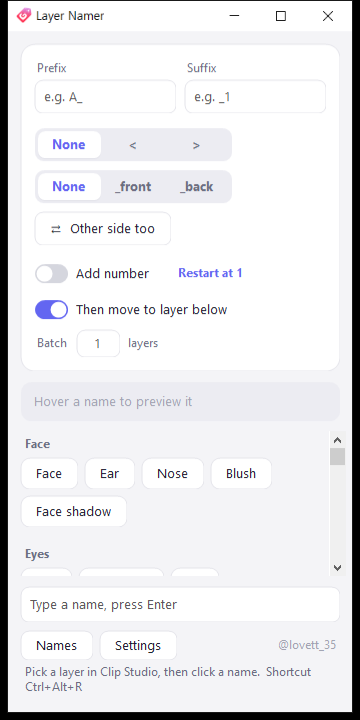
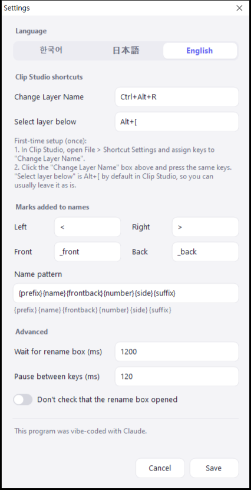

# Layer Namer

[한국어](README.md) · [日本語](README.ja.md) · **English**

A small Windows tool that names CLIP STUDIO PAINT layers with one click, made for splitting Live2D parts.
Keep it next to Clip Studio, pick a layer there, then click a name button: the layer is renamed and the selection moves to the layer below.

  
  

## Features

- **Name buttons** — click to rename the selected layer and move to the layer below.
- **Side `<` `>`** · **Front/back `_front` `_back`** — added after the name (e.g. `Front hair_front<`).
- **Add number** — each click on the same name adds 1, 2, 3…
- **Other side too** — after naming with `<`, adds the same name with `>` in one click.
- **Batch N** — names N layers downward with the same name + number. Press Esc to stop.
- **Prefix / suffix** — adds the same text before or after every name (e.g. `A_`).
- **Edit the name list** — right inside the app. `# Title` makes a group title, `---` draws a divider.
- **한국어 · 日本語 · English** — choose in Settings.

## Download

1. Download the zip from [Releases](../../releases) and unzip it.
2. Run `레이어 이름 붙이기.exe`. No installation needed.

- Works on Windows 10 / 11 (.NET Framework 4, included with Windows).
- If **"Windows protected your PC"** appears on first launch, click **More info → Run anyway**. The program isn't code-signed.
- Because it sends key presses to Clip Studio, some antivirus software may flag it.
- Settings and the name list are saved next to the exe as `settings.txt` and `names.txt`.

## First-time setup (once)

1. In Clip Studio, open **File > Shortcut Settings** and assign keys to **"Change Layer Name"** (default here: `Ctrl+Alt+R`).
2. In this program's **Settings**, click the "Change Layer Name" box and press the same keys.
3. "Select layer below" is `Alt+[` by default in Clip Studio, so you can usually leave it as is.

## How to use

1. Keep this window next to Clip Studio (it stays on top).
2. Pick the layer you want to rename in Clip Studio.
3. Click a name button. Hover a name to preview the result.
4. For a name that isn't in the list, type it in the bottom box and press Enter.

## How it works

Clip Studio's official plug-in SDK can't rename layers, so this program presses keys for you:
the "Change Layer Name" shortcut → select all → paste → Enter.

- If the rename box doesn't open, it stops without pressing anything (so Ctrl+A / Ctrl+V never hit the canvas).
- It briefly uses the clipboard to enter the name, then restores what was there.

## Build it yourself

Run `build.cmd`. It uses the C# compiler that ships with Windows, so nothing else needs to be installed.

## Author

@lovett_35

This program was vibe-coded with [Claude](https://claude.ai).

## License

[MIT](LICENSE)
