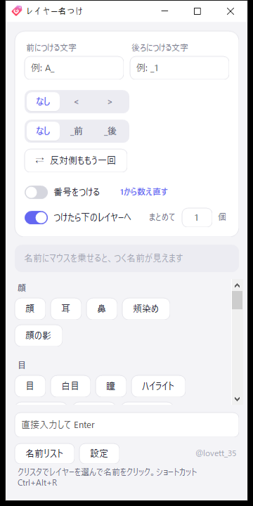
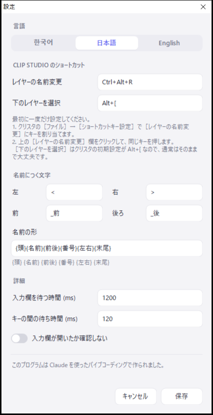

# レイヤー名つけ

[한국어](README.md) · **日本語** · [English](README.en.md)

Live2D のパーツ分けをするとき、CLIP STUDIO PAINT のレイヤー名をボタン一つでつける小さな Windows ツールです。
クリスタの横に置いておき、クリスタでレイヤーを選んで名前ボタンを押すと、そのレイヤー名が変わり、下のレイヤーへ移ります。

  
  

## できること

- **名前ボタン** — 押すと選んだレイヤーにその名前がつき、下のレイヤーへ移ります。
- **左右 `<` `>`** · **前後 `_前` `_後`** — 選ぶと名前の後ろにつきます。（例: `前髪_前<`）
- **番号をつける** — 同じ名前を押すたびに 1, 2, 3… と続けてつきます。
- **反対側ももう一回** — `<` でつけた名前を `>` ですぐもう一つつけます。
- **まとめて N 個** — 今のレイヤーから下へ N 個に同じ名前 + 番号をつけます。Esc で止まります。
- **前・後ろにつける文字** — すべての名前の前後に同じ文字をつけます。（例: `A_`）
- **名前リストの編集** — プログラムの中で編集できます。`# タイトル` はグループ名、`---` は区切り線です。
- **한국어 · 日本語 · English** — 設定で選べます。

## ダウンロード

1. [Releases](../../releases) から zip をダウンロードして展開します。
2. `레이어 이름 붙이기.exe` を実行します。インストールは不要です。

- Windows 10 / 11 で動きます。（.NET Framework 4 — Windows に標準で入っています）
- 初回起動で **「Windows によって PC が保護されました」** と出たら **詳細情報 → 実行** を押してください。署名していないプログラムのための警告です。
- クリスタにキー入力を代わりに送るプログラムなので、一部のウイルス対策ソフトが警告することがあります。
- 設定と名前リストは exe の隣の `settings.txt` · `names.txt` に保存されます。

## 最初の設定（一度だけ）

1. クリスタの **［ファイル］→［ショートカットキー設定］** で **［レイヤーの名前変更］** にキーを割り当てます。（初期値は `Ctrl+Alt+R`）
2. このプログラムの **［設定］** で［レイヤーの名前変更］欄をクリックし、同じキーを押します。
3. ［下のレイヤーを選択］はクリスタの初期設定が `Alt+[` なので、通常はそのままで大丈夫です。

## 使い方

1. クリスタの横にこのウィンドウを置きます。（常に手前に表示されます）
2. クリスタで名前を変えたいレイヤーを選びます。
3. 名前ボタンを押します。名前にマウスを乗せると、つく名前が見えます。
4. リストにない名前は下の欄に直接入力して Enter を押します。

## しくみ

クリスタの公式プラグインではレイヤー名を変えられないので、このプログラムはキー入力を代わりに送ります。
［レイヤーの名前変更］のショートカット → 全選択 → 貼り付け → Enter の順です。

- 名前の入力欄が開かなければ、何も押さずに止まります。（キャンバスに Ctrl+A · Ctrl+V が入らないように）
- 名前を入れるときにクリップボードを少し使い、終わったら元の内容に戻します。

## 自分でビルドする

`build.cmd` を実行すると、Windows に入っている C# コンパイラで exe を作ります。追加のインストールは不要です。

## 作者

@lovett_35

このプログラムは [Claude](https://claude.ai) を使ったバイブコーディングで作られました。

## ライセンス

[MIT](LICENSE)
