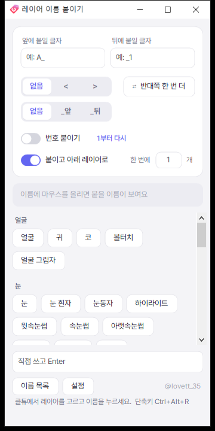
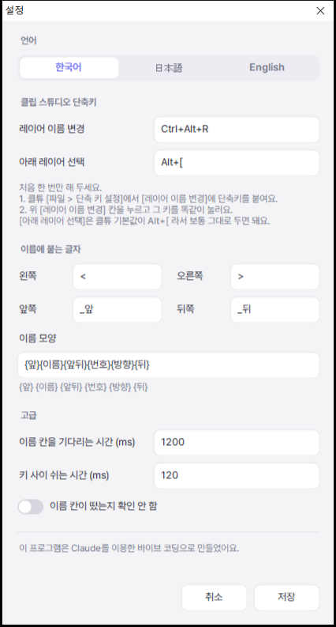

# 레이어 이름 붙이기

**한국어** · [日本語](README.ja.md) · [English](README.en.md)

Live2D 파츠 분리를 할 때 클립 스튜디오(CLIP STUDIO PAINT) 레이어 이름을 버튼 한 번으로 붙여 주는 작은 윈도우 프로그램이에요.
클튜 옆에 띄워 두고, 클튜에서 레이어를 고른 뒤 이름 버튼을 누르면 그 레이어 이름이 바뀌고 아래 레이어로 넘어가요.

  
  

## 할 수 있는 것

- **이름 버튼** — 누르면 고른 레이어에 그 이름이 붙고, 아래 레이어로 넘어가요.
- **좌우 `<` `>`** · **앞뒤 `_앞` `_뒤`** — 고르면 이름 뒤에 붙어요. (예: `앞머리_앞<`)
- **번호 붙이기** — 같은 이름을 누를 때마다 1, 2, 3… 이어서 붙어요.
- **반대쪽 한 번 더** — `<` 로 붙인 이름을 `>` 로 바로 하나 더 붙여요.
- **한 번에 N개** — 지금 레이어부터 아래로 N개에 같은 이름 + 번호를 붙여요. Esc 로 멈춰요.
- **앞 · 뒤에 붙일 글자** — 모든 이름 앞뒤에 같은 글자를 붙여요. (예: `A_`)
- **이름 목록 고치기** — 프로그램 안에서 고쳐요. `# 제목` 은 묶음 제목, `---` 는 구분선이에요.
- **한국어 · 日本語 · English** — 설정에서 골라요.

## 받기

1. [Releases](../../releases) 에서 zip 을 받아 압축을 풀어요.
2. `레이어 이름 붙이기.exe` 를 실행해요. 설치는 필요 없어요.

- Windows 10 / 11 에서 돌아가요. (.NET Framework 4 — 윈도우에 기본으로 들어 있어요)
- 처음 실행할 때 **"Windows의 PC 보호"** 창이 뜨면 **추가 정보 → 실행** 을 누르세요. 서명하지 않은 프로그램이라 뜨는 경고예요.
- 클튜에 키를 대신 눌러 주는 프로그램이라 일부 백신이 의심할 수 있어요.
- 설정과 이름 목록은 exe 옆 `settings.txt` · `names.txt` 에 저장돼요.

## 처음 설정 (한 번만)

1. 클튜 **[파일 > 단축 키 설정]** 에서 **[레이어 이름 변경]** 에 단축키를 붙여요. (기본값은 `Ctrl+Alt+R`)
2. 이 프로그램 **[설정]** 의 [레이어 이름 변경] 칸을 누르고 그 키를 똑같이 눌러요.
3. [아래 레이어 선택] 은 클튜 기본값이 `Alt+[` 라서 보통 그대로 두면 돼요.

## 쓰는 법

1. 클튜 옆에 이 창을 띄워 둬요. (항상 위에 떠 있어요)
2. 클튜에서 이름을 바꿀 레이어를 골라요.
3. 이름 버튼을 눌러요. 이름 위에 마우스를 올리면 붙을 이름이 미리 보여요.
4. 목록에 없는 이름은 아래 칸에 직접 쓰고 Enter 를 눌러요.

## 어떻게 동작하나요

클튜 공식 플러그인으로는 레이어 이름을 바꿀 수 없어서, 이 프로그램은 키를 대신 눌러요.
[레이어 이름 변경] 단축키 → 전체 선택 → 붙여넣기 → Enter 순서예요.

- 이름 칸이 뜨지 않으면 아무것도 누르지 않고 멈춰요. (캔버스에 Ctrl+A · Ctrl+V 가 들어가지 않게)
- 이름을 넣을 때 클립보드를 잠깐 쓰고, 끝나면 원래 내용으로 돌려놔요.

## 직접 빌드하기

`build.cmd` 를 실행하면 윈도우에 들어 있는 C# 컴파일러로 exe 를 만들어요. 따로 설치할 건 없어요.

## 만든 사람

@lovett_35

이 프로그램은 [Claude](https://claude.ai) 를 이용한 바이브 코딩으로 만들었어요.

## 라이선스

[MIT](LICENSE)
